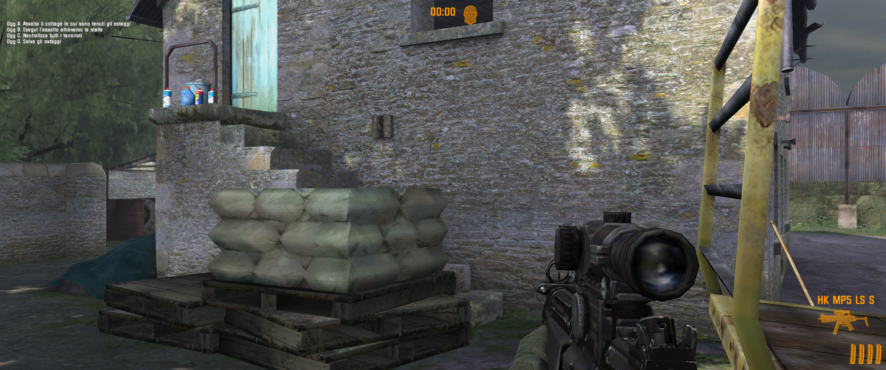
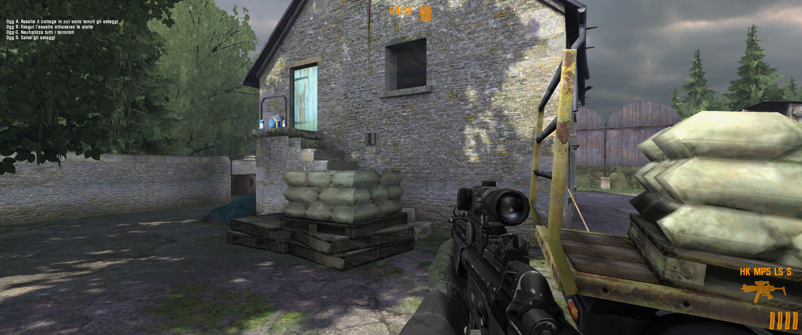

# The Regiment FOV Fix

**1.0 · Windows · ASI**

Restore the wider view on widescreen and ultrawide displays. Adjust the camera
and first-person weapon FOV independently while playing, and remove the game's
mouse acceleration and smoothing.

## Fixes

- **Field of view** — Hor+ correction for the game's Vert− behavior, preserving vertical framing on wider screens.
- **Viewmodel** — independent FOV for first-person weapons and hands.
- **Mouse input** — optional removal of acceleration and smoothing. Sensitivity remains controlled by the game's menu.
- **On-screen display** — current FOV after a hotkey adjustment or a resolution change.
- **Configuration** — remappable controls, saved FOV adjustments and one switch to disable the entire fix.

## Before / After

[**Open the interactive comparison ↔**](https://simorss.github.io/OldGamesFixes/theregiment/)

Original 3440×1440 screenshots supplied by the user, captured at different moments.

### Without fix

[](screenshots/without-fix.png)

### With fix

[](screenshots/with-fix.png)

## Installation

1. Download **TheRegiment.FOVFix-v1.0.zip** from [Releases](https://github.com/Simorss/OldGamesFixes/releases/tag/theregiment).
2. Close the game and extract the archive into its main folder, preserving the `system` and `scripts` folders.
3. Optionally edit `system/scripts/TheRegiment.FOVFix.ini`.
4. Launch the game normally. Restart after editing the INI.

```text
The Regiment/
    system/
        sas.exe
        dinput8.dll
        scripts/
            TheRegiment.FOVFix.asi
            TheRegiment.FOVFix.ini
            ThirteenAG-LICENSE.txt
```

The ZIP contains only these four added files: loader, ASI, INI and ThirteenAG's
loader license. Documentation and screenshots stay on GitHub.
If another `dinput8.dll` is already installed, preserve it and use a compatible
ASI loader. The plugin requires `InitializeASI` to be called outside `DllMain`,
as the included x86 Ultimate ASI Loader 9.7.4 does by default.

## Controls

| Setting | Decrease | Increase |
| --- | --- | --- |
| Camera FOV | F7 | F8 |
| Weapon / viewmodel FOV | F11 | F12 |

Hold a key to repeat adjustments. The four keys can be remapped in `[Keys]`.
Choose distinct keys that are free in your game bindings. Ctrl, Alt or Shift
suspends these shortcuts. Mouse sensitivity is adjusted in the game menu.

## Configuration

- **`[Main] Enabled`**: `1` enables the fix; `0` disables all its corrections, hotkeys and OSD on the next launch. `ConfigVersion` is internal and should remain unchanged.
- **`[Mouse]`**: `Enabled` controls the mouse module; `DisableAcceleration` and `DisableSmoothing` independently remove each filter when set to `1`.
- **`[FOV] BaseFOV`**: camera horizontal FOV referenced to 4:3, range 30–110 degrees. With `HorPlus=1`, a reference of 70 becomes about 102.9 degrees at 3440×1440 in the normal view.
- **`[Viewmodel]`**: independent weapon FOV, range 20–140 degrees. `Enabled=0` keeps the original weapon projection.
- **`HorPlus`**: `1` compensates for display aspect ratio; `0` keeps the manual FOV without that compensation.
- **`Step`**: reference degrees per key press, range 0.1–10. It is not the final ultrawide angle change.
- **`SaveFOV`**: `1` remembers hotkey adjustments; `0` leaves the INI value unchanged for the next session. Camera and viewmodel save independently.
- **`[OSD] DurationMs`**: display time in milliseconds, from 0 to 10000; 2200 means 2.2 seconds and 0 hides it.

Resolution changes show the actual camera FOV once the camera uses the new
dimensions. If a menu has no player camera, the notice waits until gameplay
resumes. At the same aspect ratio the FOV can remain unchanged. A hidden weapon
shows `VIEWMODEL BASE` rather than a projection that is not being drawn.

## Updating and removing

For an existing preview installation, preserve your INI and replace the ASI;
also retain the bundled loader license. For a fresh configuration, use the new
INI, which places mouse options immediately after the master switch.
The optional `tools/Update.ps1` script updates recognized previews with backups.

To remove the fix, close the game and remove its ASI, INI and log. Remove the
bundled `dinput8.dll` only if no other mods use it. The plugin does not rewrite
the game EXE or `User.ini`, or change Windows mouse settings.

## Compatibility and validation

Validated against one local 32-bit `system/sas.exe` build, SHA-256:
`f7787e7c1aa58416bc3222259cbeac02f7431794f1c3678c28eba14404a90c66`.
Other executables are left unpatched and reported in the plugin log.
Compatibility with every regional or digital edition is not established.

Native x86 hook, FOV, mouse, configuration, loader and D3D9 tests are automated.
The screenshots are user-provided; gameplay testing is manual. See the
[validation report](docs/validation.json) and [manual checklist](docs/MANUAL_TESTS.md).

## Development

Build with an x86 MinGW-w64 compiler:

```powershell
powershell -NoProfile -File .\tools\Build.ps1 -Compiler 'C:\path\to\g++.exe'
```

`-SkipGraphicsTests` is intended for headless CI and reports D3D9 rendering tests
as skipped; all other runtime tests still run. Local validation runs the full
suite. Build and test EXEs stay in `build/` and are not distributed.

[Source](src) · [Changelog](CHANGELOG.md) · [Technical details](docs/TECHNICAL_NOTES.md)

Developed with Codex. Plugin source: MIT, see `LICENSE`.
[Ultimate ASI Loader](https://github.com/ThirteenAG/Ultimate-ASI-Loader) is a
separate third-party component by **ThirteenAG**; its license is included in the ZIP.
